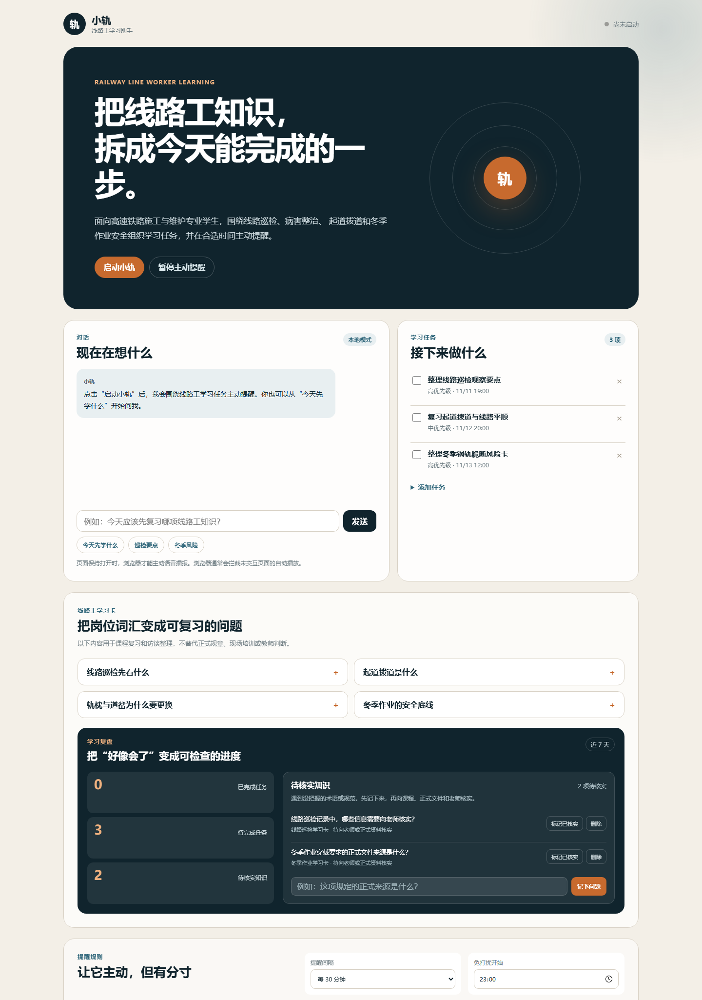

# 小轨 · 线路工学习助手

面向高速铁路施工与维护专业学生的本地学习任务助手。作品把线路工岗位知识、学习任务、截止时间、主动提醒和可选模型问答放在同一个轻量应用中。



## 解决的问题

铁路线路工的学习内容涉及线路巡检、病害整治、起道拨道、伤损轨枕更换、道岔更换和冬季作业安全。学生面对的资料来源多、术语密度高，容易出现三个问题：

1. 不知道今天先学什么。
2. 学习任务分散，容易遗漏。
3. AI回答看似流畅，但可能缺少来源或越过安全边界。

小轨把这些问题收敛为三个功能：组织待办、主动提醒、用可核验方式辅助复习。

## 当前功能

- 主动提醒下一项未完成学习任务
- 识别一小时内到期和逾期任务
- 中文语音播报
- 提醒间隔和免打扰时段
- 本地任务持久化
- 线路巡检、起拨道、轨枕道岔和冬季安全学习卡
- 学习卡一键加入“待核实知识”，并可标记核实、转回或删除
- 近 7 天任务完成数、待完成数和待核实知识汇总
- 可选DeepSeek兼容接口；未配置模型时使用本地规则回复
- 明确提示AI不能替代课程、正式规章和现场判断

## 快速开始

需要 Node.js 22 或更高版本。

```powershell
node --version
node server.mjs
```

然后打开：

```text
http://127.0.0.1:4173
```

Windows也可以双击 `start.bat`。

## 可选模型模式

模型密钥只由本地服务器读取，不写入网页代码或浏览器存储。

```powershell
$env:LLM_API_KEY="你的本机密钥"
$env:LLM_BASE_URL="https://api.deepseek.com"
$env:LLM_MODEL="deepseek-chat"
node server.mjs
```

不要把密钥提交到GitHub，也不要把个人密钥发给他人。

## 测试

```powershell
node --test test/smoke.test.mjs
```

测试覆盖任务读取、任务新增、任务完成、完成时间记录、待核实知识的新增与核实状态更新、本地学习回复和安全边界提示。

## 数据和隐私

- 任务默认保存在当前目录的 `data.json`。
- `data.json` 已加入 `.gitignore`，不会进入Git仓库。
- 默认模式只在 `127.0.0.1` 运行，不对局域网开放。
- 使用模型模式时，只有用户主动发送的问题和任务摘要会传给所配置的接口。
- 页面关闭、电脑休眠或浏览器休眠时，主动提醒可能延迟。

## 目录结构

```text
.
├─ public/
│  ├─ index.html      # 页面结构
│  ├─ styles.css      # 视觉样式
│  └─ app.js          # 交互、语音提醒和快捷学习卡
├─ test/
│  └─ smoke.test.mjs  # 本地接口测试
├─ server.mjs         # 静态服务、任务与待核实知识API、可选模型代理
├─ start.bat
└─ package.json
```

## 安全边界

本作品是个人学习工具原型，不是生产级安全系统，也不生成现场作业指令。涉及线路巡检、起道拨道、轨枕道岔更换和冬季作业的内容，必须以学校课程、现行规章和教师或现场专业人员确认的信息为准。

## 10分钟复现

1. 安装 Node.js 22 或更高版本。
2. 下载或克隆本仓库。
3. 在仓库根目录运行 `node server.mjs`。
4. 浏览器打开 `http://127.0.0.1:4173`。
5. 点击“启动小轨”，添加一项任务，并打开一张线路工学习卡。
6. 运行 `node --test test/smoke.test.mjs` 确认接口正常。
7. 如需模型模式，按上文设置三个环境变量后重启服务。

## 项目状态

当前版本为AI创新应用挑战赛省赛候选版本。Git提交记录和Prompt演进记录用于说明真实开发过程；未完成的现场安全规则不会由AI自行补写。
